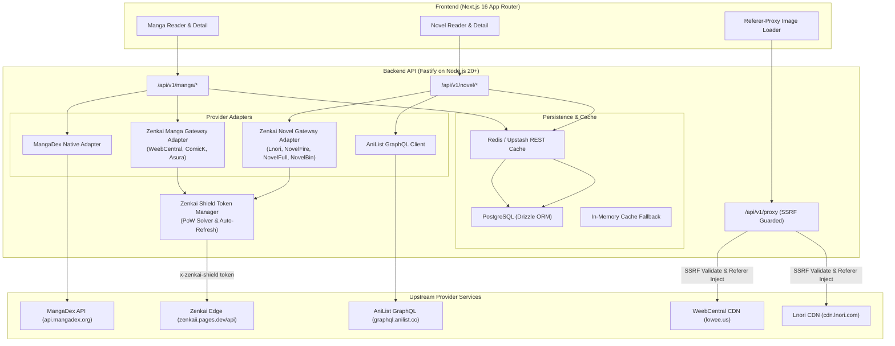

# Zenkai Extraction Architecture & Provider Adapter Contracts

## 1. System Overview & Boundaries

The Zenkai extraction system is designed around a strictly decoupled provider architecture. Upstream providers are treated as external, untrusted, and potentially volatile data sources. Internal domains (Manga Catalog, Light Novel Catalog, Reader, Library) interact exclusively with normalized canonical models.



---

## 2. Core Adapter Interfaces

### 2.1 Manga Provider Contract (`MangaProvider`)
Defined in `backend/src/providers/manga/types.ts`:

```typescript
export interface MangaProvider {
  readonly slug: string;
  readonly name: string;
  readonly priority: number;

  healthCheck(): Promise<boolean>;
  browse(query: MangaBrowseQuery): Promise<Page<MangaSummary>>;
  search(query: string, limit?: number, source?: string): Promise<Page<MangaSummary>>;
  getById(id: string, source?: string): Promise<MangaDetail | null>;
  getChapters(id: string, query?: ChapterQuery, source?: string): Promise<ProviderChapter[]>;
  getChapterPages(chapterId: string, source?: string): Promise<ChapterPages>;
}
```

### 2.2 Novel Provider Contract (`NovelProvider`)
Standardized contract implemented in `backend/src/providers/novel/index.ts`:

```typescript
export interface NovelProviderContract {
  browse(options: NovelBrowseOptions): Promise<{ items: NovelSummary[]; total: number; hasNextPage: boolean }>;
  search(queryText: string, limit?: number, source?: string): Promise<NovelSummary[]>;
  getById(id: string | number, source?: string): Promise<NovelSummary | null>;
  getChapters(idOrSlug: string | number, source?: string): Promise<NovelChapter[]>;
  getChapterContent(
    idOrSlug: string | number,
    chapterNumberOrSlug: number | string,
    source?: string
  ): Promise<NovelChapterContent | null>;
}
```

---

## 3. Automated Shield Token Lifecycle Management

To prevent `SHIELD_VERIFICATION_REQUIRED` errors from breaking upstream calls, the backend extraction layer integrates a dedicated, transparent token lifecycle manager:

```
[Outbound Request to zenkaii.pages.dev]
                |
       Valid Shield Token?
          /           \
        YES            NO / Expired
         |                  |
   Inject Header     [Request Challenge /api/shield/challenge]
   x-zenkai-shield          |
         |           [Compute SHA-256 Nonce (difficulty: 3)]
         |                  |
         |           [Post Solution /api/shield/verify]
         |                  |
         |           [Cache Token for 23.5 Hours]
         |                  |
         +<-----------------+
         |
   [Execute Request]
         |
    Status 200 OK?
       /       \
     YES       HTTP 401/403 or SHIELD_VERIFICATION_REQUIRED
      |           |
    Return     [Invalidate Cached Token & Retry with Backoff]
```

### PoW Solver Specification
- Iterates `nonce` from `0` to `500,000`.
- Hashes `${cid}:${salt}:${nonce}` using SHA-256.
- Matches `hash.startsWith("0".repeat(difficulty))`.
- Average execution time: 3-8ms in Node.js runtime.

---

## 4. Multi-Tier Persistence & Caching Strategy

1. **L1 In-Memory Cache**:
   - Short TTL (120s) for hot chapter pages and navigation links.
   - Prevents memory thrashing with strict LRU eviction (max 500 items).
2. **L2 Distributed Cache (Redis / Upstash REST)**:
   - Metadata entries: 12 hours TTL (`EX 43200`).
   - Chapter catalogues: 2 hours TTL (`EX 7200`).
   - Chapter reading content: 7 days TTL (`EX 604800`) or persistent DB storage.
   - Request Coalescing: In-flight deduplication via mutex/promise locking prevents cache stampedes on newly released chapters.
3. **L3 Durable Database Storage (PostgreSQL via Drizzle ORM)**:
   - `manga` / `chapters`: Canonical records and cross-references.
   - `novel` / `novel_chapters` / `novel_chapter_contents`: Full-length persistent paragraphs ensure zero latency on repeated reading.

---

## 5. Failure Isolation & Degradation Hierarchy

1. **Provider Quarantine**:
   - If an upstream provider fails 3 consecutive times or exceeds the 15-second timeout, its health score is degraded and the circuit breaker opens for 60 seconds.
2. **Deterministic Fallbacks**:
   - For light novels: `lnori` (volume index) -> `novelfire` (web novel chapters) -> `novelfull` -> `novelbin`.
   - For manga: `mangadex` -> `weebcentral` -> `comick`.
3. **Zero Fabrication Policy**:
   - If all providers and cached copies are exhausted, the endpoint returns an explicit structured error (`provider_unavailable` or `content_not_found`) with HTTP 502/404. It strictly **never** generates synthetic mock paragraphs or placeholder chapters.
